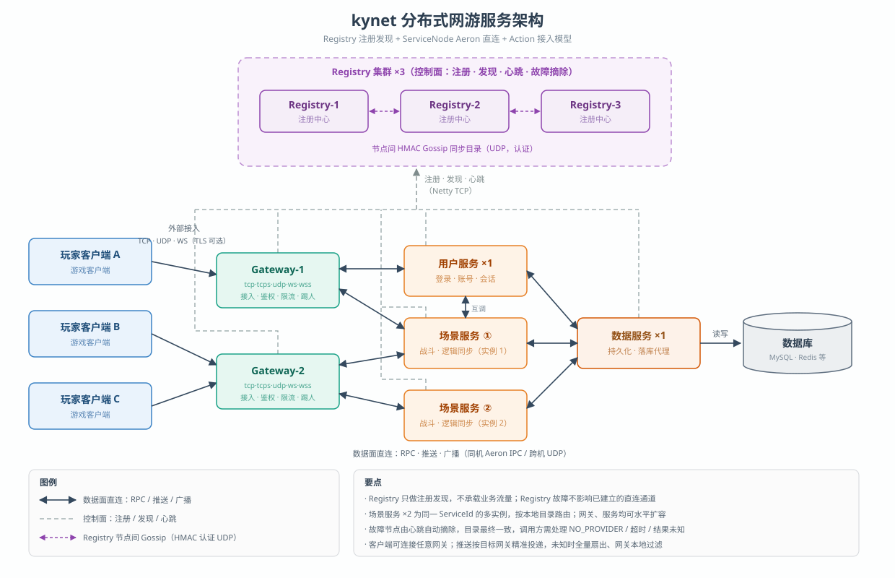

# kynet 框架说明

java 游戏服务器框架，高性能，异步无锁，事件驱动。

框架支持客户端接入、路由、传输、防护、鉴权、分布式治理、负载均衡等能力。

技术栈：Java 25 · Netty · Aeron · jprotobuf。

| 模块 | 职责 |
| --- | --- |
| `kynet-common` | 帧编解码、Protobuf 载荷、零拷贝传输层 |
| `kynet-registry` | 集群化注册中心：实例/Action 目录、心跳、故障摘除 |
| `kynet-framework` | ServiceNode、Action 模型、多协议网关、推送与踢人 |
| `examples` | 登录服务、网关接入、RPC 压测三个可运行示例 |

## 架构总览：



---

## 获取授权

Github 给项目点个 Star 即代表获得授权许可.

Github https://github.com/xiazm3/kynet

---

## 一、解决什么问题

| 传统自研遇到的问题                    | kynet 的方案 |
|------------------------------| --- |
| 客户端协议要单独处理（TCP/UDP/WebSocket）| 一个 `GatewayServer` 同时监听 `tcp://`、`tcps://`、`udp://`、`ws://`、`wss://`，统一协议模型 |
| 服务拆分后，服务注册、发现、健康检查要自己搭       | `Registry` 注册中心 + 服务自动注册，业务流量按本地目录**直连**，不经过中间转发 |
| 跨服通信性能差，中间转发层成为瓶颈            | 同主机走 Aeron IPC（共享内存），跨主机走 UDP；零拷贝帧编解码，微秒级延迟 |
| 推送、全服广播、定向广播要自己设计扇出          | `broadcast` / `pushToGateway` 一行代码，精准投递或自动扇出到全部网关 |
| 掉线顶号、封号踢人依赖客户端配合，容易被外挂绕过     | **服务端权威踢人**：框架内部控制帧直接关闭连接，不依赖客户端 |
| 公网网关裸奔，被刷包打挂                 | 内置 TLS、QPS 多级限流、连接容量、慢客户端背压、协议长度边界、Origin 白名单 |
| 单点故障                         | Registry 集群（认证 Gossip + 版本化快照），Registry 挂掉不影响已建立的直连通道 |


## 二、为什么强

**架构上：**

- **数据面直连**：Registry 只做注册发现，RPC / 推送 / 事件全部由 ServiceNode 点对点直发，没有转发层扇出开销。Registry 退出也不会断开已建立的连接。
- **零拷贝 + 低 GC**：DirectBuffer 帧视图解码、有界对象池、primitive-key 请求表，实测高吞吐下分配量下降约 25%。
- **微秒级延迟**：空闲策略可调（`yield` / `busy` / `backoff`），默认 `yield` 避免了 OS 定时器唤醒带来的毫秒级尾延迟。

**同 JVM、IPC 直连、空载荷实测数据**（开发机，`开发日志.md` 有完整过程）：

| 指标 | 结果 |
| --- | --- |
| RPC 往返延迟 | p50 ≈ 0.8 µs，p99 ≈ 42–50 µs |
| RPC 往返吞吐（inFlight=64） | ≈ 2.2M QPS |
| one-way 极限路径 | 16.8–27M 条/秒（普通路径也有百万级） |

> 以上是传输/分发层的下限数据，不含真实业务与数据库开销，不同机器会波动，用于说明量级。


## 三、快速上手

前提：本机安装 **Java 25 + Maven**。Java 25 环境 Aeron 需要额外 JVM 参数，仓库 `.mvn/jvm.config` 已配好；如果直接在 IDEA 里跑 `main`，请在 VM options 加上：

```
--add-exports=java.base/jdk.internal.misc=ALL-UNNAMED
```

引入 Maven 库

``` xml
<dependency>
    <groupId>cn.itsub</groupId>
    <artifactId>kynet</artifactId>
    <version>2.0.2</version>
</dependency>
```

### 第 1 步：启动注册中心

```bash
mvn -pl kynet-registry exec:java -Dexec.mainClass="cn.itsub.kynet.registry.RegistryMain"
```

### 第 2 步：写一个业务服务

```java
// 1. 定义消息（jprotobuf 注解，就是普通 POJO）
@ProtobufClass
public class LoginMessage {
    @Protobuf(fieldType = FieldType.STRING, order = 1)
    private String username;
    // ... getter/setter
}

// 2. 写 Action：@ActionController 声明 cmd，@ActionMethod 声明 act
@ActionController(cmd = 1)
public class LoginAction {

    @ActionMethod(act = 1)
    public ActionResult login(LoginMessage msg, ActionContext context) {
        if (!checkPassword(msg)) {
            return ActionResult.error("LOGIN_FAILED", "账号或密码错误");
        }
        context.kickOtherSessions(userId, "账号在其他设备登录"); // 顶号
        return ActionResult.success(msg);                      // 响应给调用方
    }
}

// 3. 启动：连上 Registry，注册 Action，完事
ServiceNode node = new ServiceNode("127.0.0.1", 8888, "LoginService");
node.start();
new ActionBootstrap(node).registerAction(new LoginAction());
```

### 第 3 步：启动网关（客户端入口）

```java
ServiceNode node = new ServiceNode("127.0.0.1", 8888, "GatewayService");
GatewayServer server = new GatewayServer(
        node,
        "tcp://0.0.0.0:30001",   // 可同开 tcps:// udp:// ws:// wss://
        "udp://0.0.0.0:30002",
        "ws://0.0.0.0:30003/ws"
);
GatewayLauncher.run(node, server);
```

游戏客户端连网关后，按 `cmd/act` 发请求、订阅服务端 push 即可。

### 第 4 步：服务间调用

```java
ActionResult result = node.invoke(1, 1, request, InvokeOptions.builder()
        .sessionId(sessionId)
        .userId(userId)
        .timeout(Duration.ofSeconds(3))
        .build());
LoginMessage resp = result.getValue(LoginMessage.class);
```

完整可运行示例见 [示例模块](#六示例模块)，三条命令就能跑通整个链路。

---

## 四、主要功能

### 1. Action 服务模型

业务逻辑就是一个个带注解的方法，框架负责解码、分发、执行模式：

```java
@ActionController(cmd = 2)                       // cmd 对应一类业务
public class RoomAction {

    @ActionMethod(act = 1)                       // 默认 ASYNC，业务方法不阻塞 IO 线程
    public ActionResult create(RoomMessage msg, ActionContext context) { ... }

    @ActionMethod(act = 2, mode = ActionExecutionMode.INLINE)  // 极短逻辑可内联到 IO 线程，省掉调度开销
    public ActionResult ping(ActionContext context) {
        return ActionResult.success("pong");
    }
}
```

- 方法参数自动反序列化为 jprotobuf 消息；
- `ActionContext` 提供会话信息（`sessionId` / `userId` / 来源网关）以及本服务全部能力的入口；
- `ActionContext` 还可在**整条调用链上传播 attachment**：A 调 B、B 调 C，各环节读改同一个业务上下文，结果原路带回——不用把用户状态在每层参数里传来传去。

### 2. 服务间 RPC

三种调用形态，覆盖同步、异步、fire-and-forget：

```java
node.invoke(cmd, act, payload);                          // 同步，拿 ActionResult
node.invokeAsync(cmd, act, payload);                     // CompletableFuture<ActionResult>
node.invokeOneWay(cmd, act, payload);                    // 只发不等
```

关键写操作可开启**端到端幂等重试**——重试复用同一个 requestId，接收端去重，不会重复执行：

```java
InvokeOptions options = InvokeOptions.builder()
        .sessionId(sessionId).userId(userId)
        .timeout(Duration.ofSeconds(3))
        .idempotent(true)                                // 幂等
        .maxRetries(10)
        .retryBackoff(Duration.ofMillis(100))
        .build();
```

框架的幂等缓存是有界的进程内保护，跨重启、跨实例的最终一致性（背包、交易、发奖）仍需业务唯一号 + 数据库约束兜底。

### 3. 推送与广播

```java
// action 内，一行搞定：
context.broadcast(msgId, payload);                       // 全服广播
context.broadcast(msgId, payload, 10001L);               // 定向单个玩家
context.broadcast(msgId, payload, userIds);              // 定向多个玩家
context.broadcastSelf(msgId, payload);                   // 精准推给当前玩家的网关
context.pushToGateway(msgId, payload);                   // 推给来源网关

// 任意代码处（如管理后台）：
node.pushToGateway(sessionId, userId, cmd, act, payload);
```

路由规则：已知承载网关时精准投递，否则自动扇出到全部网关、由网关本地过滤。客户端用 `cmd/act` 订阅即可收到。

### 4. 服务端权威踢人

踢人是框架内部控制帧，网关收到后注销会话并关闭连接，`UserHook.quit` 照常触发、连接配额同步释放。**不依赖客户端配合，外挂无法忽略**：

```java
context.kickSelf("违规发言");                                  // 断开当前玩家
context.kickOtherSessions(userId, "账号在其他设备登录");        // 顶号：踢旧会话，保留当前
context.kickUser(userId, "banned");                          // 封号：踢该用户所有连接
node.kickSession(sessionId, "gm kick");                      // 任意代码处精确踢
```

需要给玩家发下线提示时，先推一条业务消息，再调 kick。

### 5. 网关安全与接入

一个网关进程可以同时挂多种端点，`tcps://` / `wss://` 自动启用 TLS：

```java
server.setTlsConfig(GatewayTlsConfig.of(certPath, keyPath, keyPassword));
server.setUserHook(new ExternalUserHook());        // 上下线回调，可拿在线人数
server.setGatewayPushHandler(push -> { ... });     // 下行推送观测

// Action 访问控制：声明哪些接口要登录、哪些开放、哪些整类拒绝
server.getAccessControl().auth(1, 2);              // cmd=1 act=2 需要登录
server.getAccessControl().allow(1, 1);             // 免登录开放（如登录接口本身）
server.getAccessControl().deny(4);                 // cmd=4 整类拒绝
```

框架有合理的默认防护值，**不配置任何 setter 也直接可用**：

| 类别 | 默认值 |
| --- | --- |
| 请求限流 | 每玩家 1,000 QPS / 每 IP 20,000 / 每用户 2,000 / 每 Action 50,000 |
| 连接保护 | 总连接 100,000，每 IP 1,000，每 IP 每秒新建 200 |
| 入站边界 | 帧 1 MiB，payload 512 KiB，字符串 8 KiB |
| 慢客户端 | 有界缓冲 5 秒，超限断开（可切 DROP / CLOSE 策略） |

所有值可通过 setter 覆盖；公网部署务必自行实现 `GatewayRequestAuthenticator` 做登录鉴权，并按需配置 WebSocket Origin 白名单。

### 6. 极限性能路径

常规 `invoke` 走完整路由、重试与响应分发；状态同步、极限 IO 场景可用**预编码快路径**：

```java
// 预编码 one-way 帧，之后每次 send 只写一个 requestId 就直接入队
var sender = node.prepareFastOneWaySender(cmd, act, payload, options);
sender.send(sessionId, userId);

// 接收端在 IO 线程内直接拿 DirectBuffer 视图，零反序列化
node.setFastOneWayHandler((cmdAct, buffer, offset, length) -> { ... });
```

快路径不做业务反序列化、回调在 IO 线程执行，**不要在里面做阻塞业务**；需要严格有序时用常规调用。

### 7. Registry 集群

单 Registry 开箱即用；生产环境多节点组网只需稳定 `nodeId` + 共享集群密钥：

```powershell
$env:MAVEN_OPTS = "-Dkynet.registry.cluster.enabled=true `n
  -Dkynet.registry.cluster.secret=$env:KYNET_CLUSTER_SECRET `n
  -Dkynet.registry.nodeId=registry-1"
mvn -pl kynet-registry exec:java -Dexec.mainClass="cn.itsub.kynet.registry.RegistryMain"
```

多网卡、云环境或需要固定防火墙端口时，再按需补 `clientHost`、`clusterPort`、`discoveryAddress`（其余属性均有合理默认值，完整属性表见下文）。

- 节点间 HMAC-SHA256 认证 Gossip + 版本化目录快照，最终一致；
- 新节点在就绪前拒绝注册，避免脑裂窗口；
- Registry 全挂不影响已建立的直连数据通道；
- 目录是最终一致的，调用方需处理 `NO_PROVIDER`、超时与 `RESULT_UNKNOWN`。

完整属性表、幂等缓存参数等见 `README.md`。

---

## 五、运行示例

```bash
# 1. 注册中心
mvn -pl kynet-registry exec:java -Dexec.mainClass="cn.itsub.kynet.registry.RegistryMain"

# 2. 登录服务（Action 示例）
mvn -pl examples/example-login-service exec:java -Dexec.mainClass="cn.itsub.game.login.LoginApplication"

# 3. 网关
mvn -pl examples/example-gateway exec:java -Dexec.mainClass="game.external.GatewayServerApp"

# 4. 模拟内部调用方
mvn -pl examples/example-login-service exec:java -Dexec.mainClass="cn.itsub.game.login.LoginActionCallerApp"
```

## 六、示例模块

| 模块 | 内容 |
| --- | --- |
| `examples/example-login-service` | Action 服务：登录、attachment 链路传播、广播、踢人 |
| `examples/example-gateway` | 多协议网关、TLS、访问控制、用户上下线 Hook |
| `examples/example-rpc-action-call` | RPC 全形态调用与直连/快路径压测，含一批集群高可用与吞吐集成测试 |


---

QQ群：584781417


